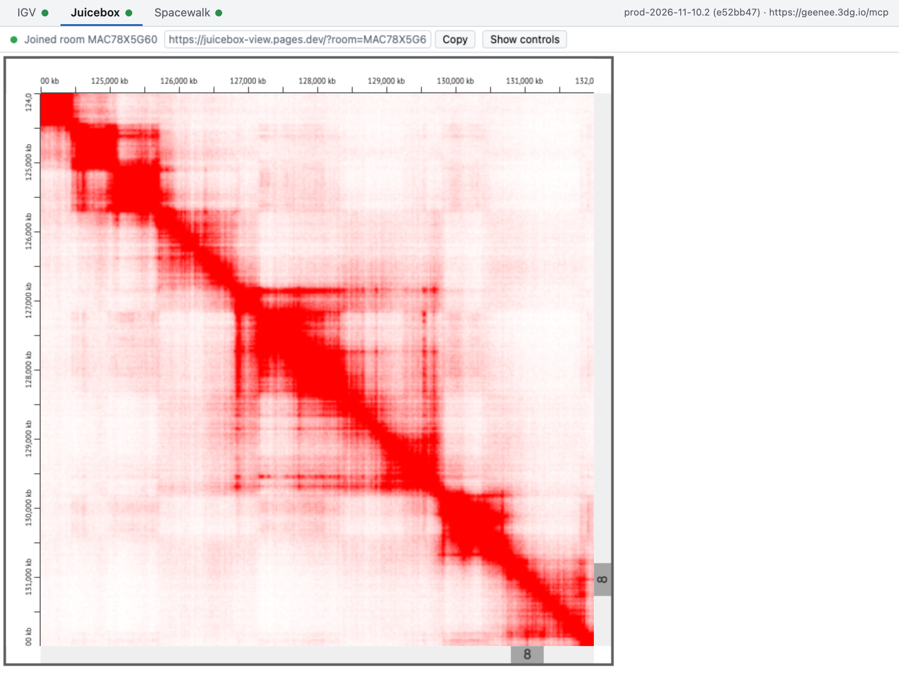

# geenee

Drive the [igv.js](https://github.com/igvteam/igv.js) genome browser, the [Juicebox](https://github.com/aidenlab/juicebox.js) contact-map viewer and the [Spacewalk](https://github.com/aidenlab/spacewalk) 3D chromatin viewer from one Claude or ChatGPT conversation, shown together beside it.

## Install

**[geenee.3dg.io/install](https://geenee.3dg.io/install)**

Add the Aiden Lab Marketplace to Claude or ChatGPT, then install the geenee Plugin from it. The page above walks you through it for each app, and the Plugin keeps itself up to date.

## Use

Ask for it in a conversation:

> Open geenee

A Card appears in the conversation, and its **Open geenee** button opens geenee beside it, with a tab for each viewer. Then just say what you want to see:

> Go to MYC
>
> Load a Hi-C map of GM12878
>
> Show me an example Spacewalk ensemble

The viewer you're talking about comes to the front. To bring someone else in, give them the Card's link or let them scan its QR code: they see what you see and can change it too, with nothing to install.

---

Working on geenee itself? See [CONTRIBUTING.md](CONTRIBUTING.md).
